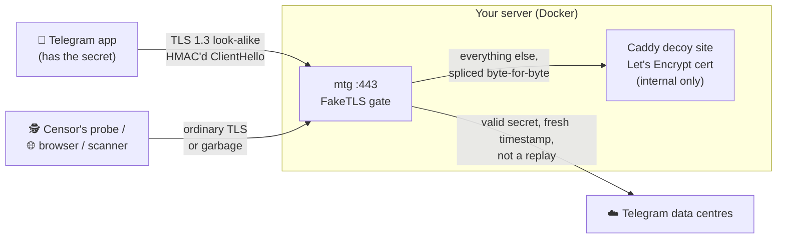

<p align="center">
  
</p>

<h1 align="center">burrow</h1>

<p align="center">
  <b>Your own stealthy, shareable Telegram proxy.</b><br>
  One command to try it, one command to deploy it, one link to share it.
</p>

<p align="center">
  <a href="https://github.com/deadboyccc/Burrow/actions/workflows/ci.yml"></a>
  <a href="https://github.com/deadboyccc/Burrow/releases"></a>
  <a href="LICENSE"></a>
  <a href="https://deadboyccc.github.io/Burrow/"></a>
</p>

burrow runs a **Telegram MTProto proxy** ([mtg](https://github.com/9seconds/mtg)) behind
a **real website with a real TLS certificate** ([Caddy](https://caddyserver.com)), in
hardened Docker containers, on a server you control. Telegram apps connect to it natively,
no extra app needed, and to anyone else (a browser, a scanner, a censor's active
probe) it is just an ordinary personal website.

Meet **Digby** 🐾, the mole on top: moles dig tunnels under walls, and this one wears
flying goggles because your messages fly through.

**One command on your server** (Debian/Ubuntu, as root) and you're done:

```bash
curl -fsSL https://raw.githubusercontent.com/deadboyccc/Burrow/main/install.sh |
  sudo BURROW_DOMAIN=notes.example.com BURROW_EMAIL=you@example.com bash
```

Or from your laptop:

```bash
git clone https://github.com/deadboyccc/Burrow.git burrow && cd burrow
./burrow try                                   # throwaway instance on 127.0.0.1, fully self-tested
./burrow deploy root@203.0.113.7 --domain notes.example.com --email you@example.com
```

> **New here?** Follow the step-by-step **[A-Z deployment guide](docs/DEPLOY.md)**. It
> starts from "I don't have a server yet" and ends with a QR code on your phone.

---

## Contents

1. [Why this design](#1-why-this-design)
2. [How it works](#2-how-it-works)
3. [Quick start](#3-quick-start)
4. [Sharing your proxy](#4-sharing-your-proxy)
5. [Commands](#5-commands)
6. [Configuration](#6-configuration)
7. [Security model](#7-security-model)
8. [Reliability](#8-reliability)
9. [Performance](#9-performance)
10. [Testing](#10-testing)
11. [Operations](#11-operations)
12. [Troubleshooting](#12-troubleshooting)
13. [Project layout](#13-project-layout)
14. [Credits and license](#14-credits-and-license)

---

## 1. Why this design

Every choice below was made for one of three goals: **safety**, **reliability** and
**performance**. Here they are, with the alternatives that lost.

### The protocol: MTProto proxy with FakeTLS

| Option | Verdict |
|---|---|
| **MTProto proxy, FakeTLS (`ee` secrets)** ✅ | Built into every official Telegram app. Shared as a single `tg://` link or QR code. The handshake is byte-for-byte a TLS 1.3 ClientHello, and only someone holding the secret can produce or recognise the special one. |
| SOCKS5 proxy | Also built into Telegram, but the handshake is plaintext and trivially fingerprinted; credentials travel in the clear. |
| VPN (WireGuard, VLESS/Reality, …) | Excellent, but needs a separate app on every device and tunnels *everything*. Overkill and harder to share when the goal is "Telegram works". |
| Legacy MTProto secrets (plain / `dd`) | Detectable by traffic analysis. mtg refuses them, and so does burrow. |

### The implementation: mtg v2

| Option | Verdict |
|---|---|
| **[mtg](https://github.com/9seconds/mtg) v2 (Go)** ✅ | Memory-safe, actively maintained (v2.3.0, Nov 2026), FakeTLS-only by design, anti-replay cache, domain fronting, IP block/allow lists, traffic-shape mimicry ("doppelganger"), Prometheus metrics, a `doctor` command, and a 19 MB `FROM scratch` image. |
| Telegram's official MTProxy (C) | Unmaintained for years, memory-unsafe, no FakeTLS fronting. |
| mtprotoproxy (Python) | Supports many users, but slower, and its stealth features trail mtg's. |
| telemt (Rust) | Promising (multi-user, per-user quotas) but younger. mtg's own docs recommend trying it too; burrow picked the longer track record. |

### The disguise: your own domain, a real site, a real certificate

The mtg author's own [best-practices note](https://github.com/9seconds/mtg/blob/master/BEST_PRACTICES.md)
(March 2026) is blunt: claiming to be `microsoft.com` from a random VPS no longer fools
anyone, because one DNS lookup shows that `microsoft.com` doesn't live there. The robust setup is:

1. a domain you own, pointing at your server;
2. a real web server on that domain with a real Let's Encrypt certificate;
3. mtg in front of it, on port 443.

DNS, SNI and the certificate then all agree, and every non-Telegram visitor gets a real
website. burrow automates exactly this and calls it **stealth mode** (the default).

**No domain?** A free wildcard-DNS name such as `203-0-113-7.sslip.io` resolves to the IP
written inside it, so you still get stealth mode with a real certificate. Point share links at
the IP (`LINK_HOST`), so clients never depend on that DNS service. **Simple mode**, which
impersonates a third-party site, is the last resort: easier to set up, easier to spot.

### The packaging: hardened Docker Compose, driven by one CLI

* **Containers:** non-root (uid 65534), read-only root filesystems, *all* Linux capabilities
  dropped, `no-new-privileges`, memory and PID limits, images **pinned by digest**.
* **One entry point:** `./burrow` (plain Bash, no runtime dependencies beyond Docker)
  renders configs, starts, checks, shares, rotates, tests and deploys. You never
  hand-edit a TOML or Caddyfile.
* **Tested like software:** 234 automated tests, including live end-to-end runs that
  push real MTProto traffic to Telegram's data centres (see [Testing](#10-testing)).

---

## 2. How it works



**Step by step, for one connection to port 443:**

1. mtg reads the first TLS record. If the client IP is on a block list (or off an allow
   list), the connection is dropped.
2. It checks the ClientHello's 32-byte "random" field, which for a real client is
   `HMAC-SHA256(secret, hello) XOR timestamp`. It also checks the SNI is your domain, the
   timestamp is within `TIME_SKEW` (5 s), and the session id hasn't been seen before (the
   anti-replay cache).
3. **Any check fails:** mtg rewinds and splices the raw bytes to the decoy Caddy server,
   which completes a genuine TLS 1.3 handshake with a genuine certificate and serves your
   site. A probe sees exactly what a browser sees.
4. **All checks pass:** mtg answers with a ServerHello whose random is in turn an HMAC (so
   the client knows it reached the real proxy), then relays the obfuscated MTProto stream
   to the right Telegram data centre, wrapped in TLS application-data records.

The decoy is never published on 443 itself: the only way to it is *through* mtg. Port 80
goes straight to Caddy, for Let's Encrypt HTTP-01 challenges and http→https redirects,
just like any website.

### Two modes

| | **stealth** (default) | **simple** |
|---|---|---|
| Needs | a domain pointing at the server, or a free wildcard-DNS name like `203-0-113-7.sslip.io` | nothing |
| What probes see | **your** site, **your** valid certificate | the real `COVER_DOMAIN` site, relayed |
| DNS ↔ IP ↔ SNI consistent | ✅ yes | ❌ no (the cover domain doesn't resolve to you) |
| Ports | 443 (+80 for ACME) | 443 |
| Use when | always, if you can get a domain | quick tests; places where domains are a problem |

---

## 3. Quick start

**Requirements:** Linux (or macOS) with Docker Engine 25+ and Compose ≥ 2.24.4, Bash ≥ 4.4.
On a fresh Debian/Ubuntu server, `scripts/install-host.sh` installs all of it.

### Install on a server (one command)

Run this **on the server**, as root. Settings are environment variables:

```bash
curl -fsSL https://raw.githubusercontent.com/deadboyccc/Burrow/main/install.sh |
  sudo BURROW_DOMAIN=notes.example.com BURROW_EMAIL=you@example.com bash

# no domain? your IP as a free wildcard-DNS name: still stealth mode, still a real certificate
curl -fsSL https://raw.githubusercontent.com/deadboyccc/Burrow/main/install.sh |
  sudo BURROW_DOMAIN=203-0-113-7.sslip.io BURROW_LINK_HOST=203.0.113.7 bash

# last resort, simple mode: impersonate a popular site reachable where your users are
curl -fsSL https://raw.githubusercontent.com/deadboyccc/Burrow/main/install.sh |
  sudo BURROW_COVER_DOMAIN=www.wikipedia.org bash
```

It installs git/curl if needed, fetches the pinned burrow release into `/opt/burrow`,
prepares the host (Docker, firewall, BBR, NTP, unattended upgrades, watchdog), creates
the secret, starts the proxy, runs the full smoke test, and prints your links and QR
code. **Re-run the same command to upgrade.** It keeps your secret.

| Variable | Meaning |
|---|---|
| `BURROW_DOMAIN` | stealth mode: your domain (A record → this server) |
| `BURROW_COVER_DOMAIN` | simple mode: a popular HTTPS site reachable where your users are |
| `BURROW_EMAIL` | Let's Encrypt account email (optional) |
| `BURROW_PORT` | public proxy port (default `443`) |
| `BURROW_LINK_HOST` | what links point at (default: the domain, or the IP in simple mode) |
| `BURROW_ENABLE_IPV6` | `true` to also listen on IPv6 |
| `BURROW_SSH_PORT` | your SSH port, if it can't be detected (sshd's ports are always kept open) |
| `BURROW_DIR` / `BURROW_REF` | install directory (`/opt/burrow`) / release to install |
| `BURROW_INIT_ARGS` | extra `burrow init` flags, e.g. `"--subnet 10.77.1.0/28"` |
| `BURROW_SKIP_HOST_SETUP=1` | leave Docker, firewall and sysctl to you |
| `BURROW_DRY_RUN=1` | print every step, change nothing |

### Try it locally (2 minutes, nothing exposed)

```bash
./burrow try          # builds, starts on 127.0.0.1, runs the full smoke test, shows a QR
./burrow try --down   # removes every trace
```

Open the printed `tg://` link in Telegram Desktop **on the same machine** and you are
using your own proxy.

### Deploy to a server (one command, from your laptop)

```bash
./burrow deploy root@203.0.113.7 --domain notes.example.com --email you@example.com
```

This uploads burrow to `/opt/burrow`, prepares the host (Docker, firewall, BBR, NTP,
unattended upgrades, watchdog), generates the secret **on the server**, starts the stack,
runs the smoke test on the server *and* again from your laptop across the internet, then
prints your share link. Re-running it upgrades burrow and keeps your secret.

Prefer doing it by hand, or want every detail? → **[docs/DEPLOY.md](docs/DEPLOY.md)**.

---

## 4. Sharing your proxy

```bash
./burrow link     # tg://… (opens the app) and https://t.me/proxy?… (works anywhere)
./burrow share    # the links + a QR code in the terminal + PNG/SVG files in state/share/
```

* **Anyone with the link can use the proxy.** Send it the way you'd send a key: privately.
* **QR codes are made offline.** `mtg access` prints QR codes as links to a public QR
  web service, which would hand your secret to a third party. burrow renders them locally.
* **Revoking access:** `./burrow rotate` makes a new secret. Every old link stops
  working immediately (old secrets now just reach the decoy website); send the new link to
  the people who should keep access.
* **Per-person links?** mtg serves exactly one secret per instance, on purpose (simpler,
  smaller attack surface), and burrow runs one proxy per server. A second burrow checkout on
  the same host is refused rather than allowed to take over the first one's containers. If
  you need individually revocable access, look at telemt.
* **Links point at your domain by default.** If your domain gets DNS-poisoned, set
  `LINK_HOST` to the server's IP: links keep working and the SNI still says your domain.
* **Test any link, from anywhere:** `./burrow smoke --link 'tg://proxy?…'` checks a
  proxy exactly the way an app (and a censor) reaches it. No `.env` needed.

---

## 5. Commands

| Command | What it does |
|---|---|
| `init --domain D [--email E]` | Create `.env` with a fresh secret (`init --help` lists every flag). |
| `up [--no-wait]` | Render config, (re)start what changed, wait until FakeTLS answers, print links. |
| `try [--down]` | Throwaway local instance on 127.0.0.1 with self-signed TLS, self-tested. |
| `deploy user@host …` | Install or upgrade on a server over SSH (`deploy --help`). |
| `link [--format tg\|tme\|secret]` | Print share links on stdout. |
| `share` | Links + terminal QR + private PNG/SVG in `state/share/`. |
| `rotate [--yes]` | New secret; old links stop working. |
| `status` | Containers, a live FakeTLS check, traffic counters. |
| `smoke [--link L] [--insecure] [--no-telegram]` | End-to-end self-test (see below). `--link` takes any proxy link, with the secret in hex or base64. |
| `doctor` | Host, clock, BBR, DNS, `.env`, decoy, plus `mtg doctor`. |
| `logs [-f] [mtg\|decoy]` | Container logs. |
| `restart`, `down [--volumes]`, `update` | Lifecycle. `update` pulls the pinned images and recreates. |
| `watchdog` | One health check, restarting what's stuck (run by a systemd timer). |
| `config show\|get K\|set K V …` | Inspect or change settings. All pairs are validated together before anything is written; changing `DOMAIN` (or the mode) regenerates the secret. `show` hides the secret and SOCKS passwords. |
| `render` | Write `state/` without starting anything. |
| `uninstall [--purge]` | Remove containers, volumes, state and the watchdog (`--purge`: also `.env`). |

`burrow smoke` runs these checks against the live stack (or any `--link`):

1. a valid client completes the FakeTLS handshake;
2. **Telegram answers through the proxy**: a real `req_pq_multi` → `resPQ` exchange with a
   Telegram data centre;
3. a replayed handshake is refused;
4. a client with a 10-minute clock skew is refused;
5. a wrong secret gets the cover website, not the proxy;
6. browsers and probes see a real website over real TLS;
7. plain-HTTP scanners get a normal web-server answer;
8. metrics are served on 127.0.0.1 only.

---

## 6. Configuration

All settings live in `.env` (mode 0600), written by `burrow init`. Every key, with its
default and an explanation, is documented in **[.env.example](.env.example)**. Change
settings with `./burrow config set KEY VALUE` (validated, and rolled back if invalid), then
`./burrow up`: only the containers whose rendered config changed are recreated.

The ones you are most likely to touch:

| Key | Default | Notes |
|---|---|---|
| `DOMAIN` | | stealth mode: your domain (A record → server) |
| `ACME_EMAIL` | | Let's Encrypt account email (expiry notices) |
| `LINK_HOST` | domain | put an IP here if DNS for your domain is poisoned |
| `PROXY_PORT` | `443` | keep 443: real HTTPS lives there |
| `ENABLE_IPV6` | `false` | dual-stack, with real client IPs over IPv6 |
| `UPSTREAM_PROXIES` | | `socks5://…` if Telegram is blocked *from the server* |
| `BLOCKLIST_URLS` | FireHOL abusers + Spamhaus DROP | refreshed daily |
| `LOCAL_BLOCKLIST` / `LOCAL_ALLOWLIST` | | your own netset files |
| `DOPPELGANGER_URLS` | | HTTPS URLs whose timing mtg mimics (e.g. assets on your own site) |
| `LOGGING` | `on` | `off` keeps **no** logs (mtg logs client IPs at info level) |
| `CONCURRENCY` | `8192` | max simultaneous client connections |

**Make the decoy yours.** The shipped site is a template, and identical templates on many
servers would be a fingerprint. Copy it and edit freely:

```bash
cp -r site site.local && $EDITOR site.local/index.html && ./burrow up
```

`site.local/` is git-ignored and used automatically, and re-running the installer never
touches it. `{{SITE_NAME}}`, `{{DOMAIN}}`, `{{YEAR}}` and `{{ACCENT}}` are filled in for you.
`burrow doctor` warns while you're still on the template.

Rules for your own pages:

- The decoy sends a strict Content-Security-Policy. Put CSS in files (`<link rel="stylesheet"
  href="/style.css">`), not in `<style>` blocks or `style=""` attributes. Scripts are blocked
  entirely, and images must come from the site itself.
- Keep a `404.html`: scanners probe paths like `/wp-admin`.
- Dotfiles (`.git`, `.DS_Store`) are never published.

---

## 7. Security model

### What burrow protects against

| Threat | Defence |
|---|---|
| Passive DPI recognising Telegram | FakeTLS: the bytes on the wire look like TLS 1.3 to your own domain. |
| Active probing ("are you a proxy?") | Anything without the secret is spliced to a real website with a real certificate. |
| Replay of a captured handshake | mtg's anti-replay cache, plus a ±5 s timestamp window. |
| SNI/DNS/IP mismatch heuristics | Stealth mode: your domain resolves to your server and serves its own certificate. |
| Traffic-shape analysis | mtg's doppelganger timing mimicry (`DOPPELGANGER_URLS`). |
| Abuse from known-bad networks | FireHOL/Spamhaus block lists, optional allow lists. |
| Container breakout impact | Non-root, read-only rootfs, zero capabilities, `no-new-privileges`, memory and PID caps. |
| Secret leakage | `.env` and share files are 0600; secrets reach probe containers via the environment, never argv; `config show` and logs redact them; QR codes are rendered offline. |
| Supply-chain tampering | Images pinned by sha256 digest, Python deps installed with `--require-hashes`, test deps pinned by commit, CI actions pinned by SHA. Dependabot updates the images, the Python deps and the actions; the bats commits and the lint/scan images are bumped by hand. |
| Config injection | `.env` is parsed as data (never `source`d), unknown keys are ignored, and every value is validated against a strict pattern before it reaches TOML, YAML or a Caddyfile. |

### What it does not do

* **It is not an anonymity tool.** Your server's provider can see that your server talks
  to Telegram, and Telegram sees the server's IP, not your users'. Message contents are
  protected by Telegram's own MTProto encryption either way.
* **It can't hide that a server exists.** A sufficiently motivated censor can still block
  your IP. Have a plan B: another server, `LINK_HOST`, `UPSTREAM_PROXIES`.
* **Anyone with the link can use the proxy.** Share accordingly; rotate if it leaks.
* **The operator sees metadata.** With `LOGGING=on`, mtg logs client IPs. Use
  `LOGGING=off` if you don't want that data to exist.

### Host hardening done by `scripts/install-host.sh`

ufw (deny inbound except rate-limited SSH, 80 and 443), unattended security upgrades
(including Docker's own packages), NTP, Docker from Docker's signed apt repository with
`live-restore`, and a hardened systemd unit for the watchdog. SSH stays reachable on
`--ssh-port` *and* on every port sshd is configured for; if no SSH port can be determined,
the firewall is left off rather than risking a lockout. Docker publishes ports through its own iptables chain, before ufw sees them. burrow publishes
only the proxy and HTTP ports publicly; metrics are bound to 127.0.0.1.

Found a vulnerability? See [SECURITY.md](SECURITY.md).

---

## 8. Reliability

* **Self-checking start:** `burrow up` only reports success once a real FakeTLS handshake
  succeeds. In stealth mode it then checks that the decoy serves HTTPS, and warns (with the
  likely cause) while the certificate is still being issued.
* **Crash recovery:** `restart: unless-stopped` on every service (tested by `kill -9`).
* **Hang recovery:** a systemd timer runs `burrow watchdog` every 5 minutes. If the proxy
  stops answering handshakes (three tries), it is recreated (tested with `docker pause`). If
  the probe itself can't run, the proxy is left alone instead of dropping every user.
* **Daemon upgrades:** Docker `live-restore` keeps containers serving while `dockerd`
  restarts.
* **Precise reconfiguration:** rendered files carry content hashes as container labels, so
  `burrow up` recreates exactly the containers whose config changed. Unchanged files keep
  their inode, so running containers never get stranded on a deleted bind mount.
* **Certificates:** Caddy renews automatically. The certificate volume survives
  `burrow down` (only `down --volumes` deletes it), so restarts never hit Let's Encrypt
  rate limits.
* **Time:** NTP is enforced at install, and `doctor` checks clock drift (FakeTLS depends
  on it).

---

## 9. Performance

* **mtg** is a lean Go relay built on pooled buffers, with `TCP_NOTSENT_LOWAT` to avoid
  bufferbloat. Measured idle footprint of the whole stack: **~3.5 MiB** (mtg) + **~14 MiB** (decoy). A 1 vCPU / 1 GB VPS comfortably serves
  hundreds to a few thousand concurrent Telegram users; network bandwidth runs out first.
* **Kernel tuning** (`deploy/sysctl/99-burrow.conf`): **BBR** congestion control + `fq`,
  larger accept queues and socket buffers, MTU probing, no slow-start-after-idle. These
  matter most on the lossy, long-distance paths censored users tend to have.
* **No userland proxy in the path:** published ports are kernel DNAT, and client source IPs
  are preserved (block lists and metrics see real addresses, including over IPv6 with
  `ENABLE_IPV6=true`).
* **Per-container tuning:** `somaxconn` 4096, a wide ephemeral port range for upstream
  connections, 65 536 file descriptors.
* **Sizing knobs:** `CONCURRENCY`, `MTG_MEMORY_LIMIT`, `IDLE_TIMEOUT`.

---

## 10. Testing

```bash
make test              # everything (needs Docker; e2e needs internet)
make test-unit         # bash (bats) + Python (pytest), no network
make test-integration  # real mtg/Caddy parse every config; install script dry run in Debian
make test-e2e          # live stacks on 127.0.0.1, real Telegram round trips
make lint              # shellcheck, shfmt, ruff, compose validation
```

| Suite | What it proves |
|---|---|
| **unit/** (bats, 97 tests) | validators reject injection; `.env` parsing never executes code; secrets, links, rendering, permissions, inode-stable re-rendering, the CLI's argument handling. |
| **tools/tests/** (pytest, 83 tests) | the FakeTLS/obfuscated2/MTProto client against a line-by-line port of mtg's server checks; a full Telegram round trip through a fake relay; probe verdicts and time budgets against hostile and quirky in-process servers (endless empty records, slow drips, resets, terminal-escape injection); QR output. |
| **integration/** (28 tests) | the pinned **mtg binary** accepts every config variant; **Caddy** validates every Caddyfile; the compose model is hardened (caps, users, ports, digests); `install-host.sh` plans the right steps in a real Debian container (dry run). |
| **e2e/** (26 tests) | full stacks: all smoke checks including **real Telegram resPQ round trips**; link testing from the host network; container hardening as actually run; decoy pages, 404s, headers and redirects; rotation revokes old links; crash recovery (`kill -9`); hang recovery (watchdog); block and allow lists; clock-skew rejection; simple mode against a real cover site; the whole `burrow try` flow; `burrow deploy` end to end (upload, init on the "server", smoke from both ends, re-deploy keeps the secret); the one-command installer for real (fetch, configure, start, smoke, share, then an in-place upgrade that keeps the secret). |
| **smoke** (`burrow smoke`) | the same live checks, against your deployment, on demand or after every deploy. |

CI runs every suite on each push and pull request, plus weekly to catch upstream changes
(Telegram, images, CAs). It also runs a gitleaks secret scan.

---

## 11. Operations

| Task | How |
|---|---|
| See health and traffic | `./burrow status` |
| Prometheus | scrape `http://127.0.0.1:3129/metrics` on the server (`mtg_*` metrics) |
| Logs | `./burrow logs -f mtg` (rotated: 3 × 10 MB per container) |
| Update burrow | re-run the install command, or `git pull && ./burrow up`, or re-run `burrow deploy` |
| Update images only | `./burrow update` |
| Change a setting | `./burrow config set KEY VALUE && ./burrow up` |
| Revoke all links | `./burrow rotate` |
| Back up | `.env` (the secret) and, optionally, the `burrow_decoy-data` volume (certificates) |
| Move servers | copy `.env` to the new server, `./burrow config set PUBLIC_IPV4 <new IP>`, point DNS at it, `./burrow up`; domain-based links keep working |
| Remove | `./burrow uninstall --purge` |

---

## 12. Troubleshooting

| Symptom | Likely cause → fix |
|---|---|
| `burrow up` says the decoy has no valid certificate | DNS not pointing at the server yet, or port 80 blocked by a cloud firewall. Check `dig +short DOMAIN`, open 80/443 in your provider's panel, then `./burrow logs decoy`. |
| Telegram shows "connecting…" forever | Run `./burrow smoke --link "$(./burrow link --format tg)"` from another network. If the smoke passes there, your local network is blocking the server's IP. |
| Works on Wi-Fi, not on mobile data (or vice versa) | IP-level blocking on one network. Try `LINK_HOST` = IP, or a second server. |
| Many clients rejected | Check the clock: `./burrow doctor`. Clients with wrong clocks are refused by design (`TIME_SKEW`). |
| `Pool overlaps with other one on this host` | Another Docker network uses `10.203.47.0/28`: `./burrow config set EDGE_SUBNET 10.77.1.0/28 DECOY_IP 10.77.1.10`. |
| Telegram blocked *from the server* | Set `UPSTREAM_PROXIES=socks5://…` (e.g. a local sing-box/WireGuard egress). |
| Port 443 already in use | Another web server owns it. burrow must own 443: move the other site behind burrow's decoy (`site.local/`), or use another server. |
| My custom page shows up unstyled | Inline `<style>` is blocked by the decoy's Content-Security-Policy. Move the CSS into `site.local/style.css` and link it. |
| No domain, but I want a real certificate | Use `<your-ip-with-dashes>.sslip.io` as the domain and set `LINK_HOST` to the IP. |

---

## 13. Project layout

```
burrow                  the CLI (Bash)
install.sh              one-command server installer (curl | sudo bash)
lib/                    CLI modules: config, validation, rendering, secrets, links, compose
compose.yaml            hardened stack: mtg, decoy-init, decoy (Caddy), tools
compose.ipv6.yaml       overlay for ENABLE_IPV6=true
compose.nolog.yaml      overlay for LOGGING=off
site/                   decoy website template (copy to site.local/ to customise)
tools/                  burrow-tools image: FakeTLS/MTProto probe client, QR codes (Python)
scripts/install-host.sh server preparation (Docker, firewall, sysctl, NTP, watchdog)
scripts/lint.sh, test.sh
deploy/                 systemd watchdog units, sysctl tuning
tests/                  unit/, integration/, e2e/ (bats)
docs/DEPLOY.md          the A-Z deployment guide
website/                GitHub Pages site
assets/digby.svg        the mascot
```

Generated at runtime (git-ignored): `.env`, `state/` (rendered configs, share files),
`.try/`, `site.local/`.

---

## 14. Credits and license

* [mtg](https://github.com/9seconds/mtg) by Sergey Arkhipov (9seconds), MIT: the proxy itself.
* [Caddy](https://caddyserver.com), Apache 2.0: the decoy web server and automatic HTTPS.
* [segno](https://github.com/heuer/segno), [cryptography](https://cryptography.io): QR codes and AES for the probe client.
* Digby the mole: original artwork made for this project (`assets/digby.svg`).

burrow is released under the [MIT License](LICENSE). Telegram is a trademark of its
owners; burrow is an independent project, not affiliated with Telegram.
