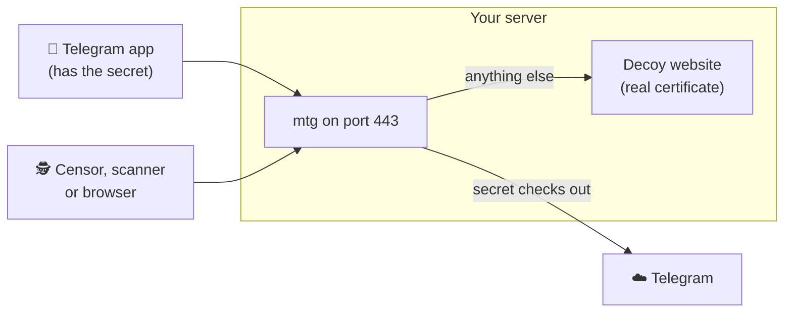

<p align="center">
  
</p>

<h1 align="center">burrow</h1>

<p align="center">
  <b>Your own stealthy, shareable Telegram proxy.</b><br>
  One command to install it, one link to share it.
</p>

<p align="center">
  <a href="https://github.com/deadboyccc/Burrow/actions/workflows/ci.yml"></a>
  <a href="https://github.com/deadboyccc/Burrow/releases"></a>
  <a href="LICENSE"></a>
  <a href="https://deadboyccc.github.io/Burrow/"></a>
</p>

burrow runs a **Telegram proxy** ([mtg](https://github.com/9seconds/mtg)) hidden behind a
**real website with a real certificate**, in hardened Docker containers, on a server you
control. Telegram apps connect to it natively, with no extra app. To everyone else (browsers,
scanners, censors) it is just an ordinary website.

Meet **Digby** 🐾: moles dig tunnels under walls, and this one wears flying goggles because
your messages fly through.

## Install

On a fresh Debian or Ubuntu server, as root:

```bash
curl -fsSL https://raw.githubusercontent.com/deadboyccc/Burrow/main/install.sh |
  sudo BURROW_DOMAIN=notes.example.com bash
```

**No domain?** Use your server's IP as a free wildcard-DNS name. It still gets a real
certificate:
`sudo BURROW_DOMAIN=203-0-113-7.sslip.io BURROW_LINK_HOST=203.0.113.7 bash`.

That one command prepares the server (Docker, firewall, kernel tuning, automatic updates,
watchdog), creates your secret, starts the proxy, tests it end to end, and prints your share
link and QR code. Run it again any time to upgrade; your secret is kept.

| Prefer… | Do this |
|---|---|
| Step-by-step help, from renting a server to scanning the QR code | **[Deployment guide](docs/DEPLOY.md)** |
| Deploying from your laptop over SSH | `./burrow deploy root@203.0.113.7 --domain notes.example.com` |
| Trying it on your own machine first | `git clone https://github.com/deadboyccc/Burrow.git burrow && cd burrow && ./burrow try` |

## How it works



- The Telegram app's connection looks like ordinary HTTPS to your domain. Only someone who
  holds the secret can produce or recognise the difference.
- Everything else (probes, browsers, replayed or stale handshakes) is passed to a real
  website with a real certificate, so it gets exactly what a normal site would serve.
- Read more in **[Design](docs/DESIGN.md)**.

## Everyday use

Run these on the server, in `/opt/burrow`:

| Command | What it does |
|---|---|
| `./burrow status` | health, connected users, traffic |
| `./burrow share` | share links and a QR code |
| `./burrow rotate` | new secret: every old link stops working |
| `./burrow smoke` | full end-to-end self-test |
| `./burrow doctor` | diagnose the host, DNS, clock and config |

Every command is in **[Usage](docs/USAGE.md)**.

## What you get

- **Stealthy.** It looks like a normal HTTPS website, with a real certificate on your domain.
- **Hardened.**
  - Containers run non-root, on read-only filesystems, with no Linux capabilities.
  - Images are pinned by digest.
  - Secrets never appear in command lines or logs.
- **Private by default.** Nothing records who connects.
- **Self-healing.**
  - Crashed or frozen proxies restart themselves.
  - Certificates renew themselves, and security updates install themselves.
- **Fast.**
  - A lean Go relay, with BBR network tuning.
  - A 1 CPU / 1 GB server handles hundreds of users.
- **Tested.** 263 automated tests, including live connections to Telegram.

## Documentation

| Page | For |
|---|---|
| [Deployment guide](docs/DEPLOY.md) | getting a proxy running, step by step |
| [Usage](docs/USAGE.md) | commands, sharing, revoking access, self-tests |
| [Configuration](docs/CONFIGURATION.md) | installer options, settings, your own decoy website |
| [Operations](docs/OPERATIONS.md) | capacity, monitoring, upgrades, backups, troubleshooting |
| [Threat model](docs/THREAT-MODEL.md) | what burrow protects against, what it doesn't, privacy |
| [Design](docs/DESIGN.md) | how it works, and why these technologies |
| [Development](docs/DEVELOPMENT.md) | tests, CI, project layout |
| [Changelog](CHANGELOG.md) · [Security policy](SECURITY.md) · [Contributing](CONTRIBUTING.md) | |

## Credits and license

Built on [mtg](https://github.com/9seconds/mtg) (MIT) and [Caddy](https://caddyserver.com)
(Apache 2.0), with [segno](https://github.com/heuer/segno) and
[cryptography](https://cryptography.io). Digby is original artwork made for this project.

burrow is released under the [MIT License](LICENSE). Telegram is a trademark of its owners;
burrow is an independent project, not affiliated with Telegram.
