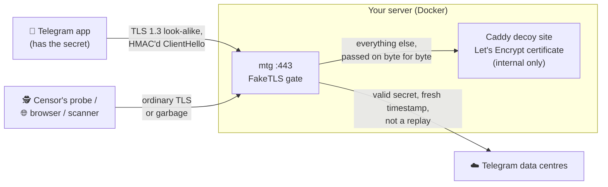

# Design

Every choice below serves three goals: **safety**, **reliability** and **performance**.

## How a connection is handled

For each connection to port 443:

1. **Lists.** A client IP on a block list (or missing from an allow list) is dropped.
2. **Checks.** mtg checks the TLS ClientHello's 32-byte "random" field. For a real client
   it is `HMAC-SHA256(secret, hello)` XOR a timestamp. mtg also checks that the SNI is your
   domain, that the timestamp is within 5 seconds, and that this handshake hasn't been seen
   before.
3. **Any check fails:** the raw bytes go to the decoy web server, which completes a genuine
   TLS 1.3 handshake with a genuine certificate. A probe sees exactly what a browser sees.
4. **All checks pass:** mtg answers with a ServerHello whose random is in turn an HMAC, so
   the client knows it reached the real proxy. It then relays the encrypted MTProto stream
   to the right Telegram data centre, wrapped in ordinary TLS records.

The decoy is never exposed on port 443 itself; the only way to it is *through* mtg. Port 80
goes straight to it, for certificate renewals and HTTP→HTTPS redirects, like any website.

## Two modes

| | **Stealth** (default) | **Simple** (last resort) |
|---|---|---|
| Needs | a domain pointing at the server, or a free name like `203-0-113-7.sslip.io` | nothing |
| What probes see | **your** site, **your** certificate | a third-party "cover" site, relayed |
| DNS, IP and SNI agree | ✅ | ❌ (the cover site doesn't live on your IP) |
| Ports | 443, plus 80 for certificates | 443 |

## Why these technologies

### Protocol: MTProto proxy with FakeTLS

| Option | Verdict |
|---|---|
| **MTProto proxy, FakeTLS (`ee` secrets)** ✅ | Built into every official Telegram app and shared as one link or QR code. The handshake is a TLS 1.3 ClientHello that only the secret holder can produce or recognise. |
| SOCKS5 proxy | Also built into Telegram, but its plaintext handshake is easy to fingerprint. |
| VPN (WireGuard, VLESS/Reality, …) | Excellent, but needs an extra app on every device and tunnels everything. |
| Legacy secrets (plain / `dd`) | Detectable by traffic analysis; refused by mtg and burrow. |

### Proxy: mtg v2

| Option | Verdict |
|---|---|
| **[mtg](https://github.com/9seconds/mtg) v2 (Go)** ✅ | Memory-safe and actively maintained. FakeTLS-only, with anti-replay protection, domain fronting, IP lists, traffic-shape mimicry, metrics, a `doctor` command, and a 19 MB image. |
| Telegram's official MTProxy (C) | Unmaintained for years, memory-unsafe, no FakeTLS fronting. |
| mtprotoproxy (Python) | Many users per proxy, but slower and less stealthy. |
| telemt (Rust) | Promising (multi-user, quotas) but younger; burrow chose the longer track record. |

### Disguise: your own domain, real site, real certificate

mtg's own [best-practices note](https://github.com/9seconds/mtg/blob/master/BEST_PRACTICES.md)
(March 2026) puts it plainly: claiming to be `microsoft.com` from a random VPS fools no one,
because one DNS lookup shows `microsoft.com` doesn't live there. The robust setup is a
domain you own, pointing at your server, with a real website and a real Let's Encrypt
certificate, and mtg in front of it. DNS, SNI and the certificate then all agree. burrow
automates exactly this as **stealth mode**.

### Packaging: hardened Docker Compose and one CLI

- **Containers** run as an unprivileged user, on read-only filesystems, with every Linux
  capability dropped, `no-new-privileges`, memory and process limits, and images pinned by
  digest.
- **One entry point:** `./burrow`, plain Bash with no dependencies beyond Docker. It
  generates every config file, so you never hand-edit TOML or a Caddyfile.
- **Tested like software:** see [Development](DEVELOPMENT.md).
